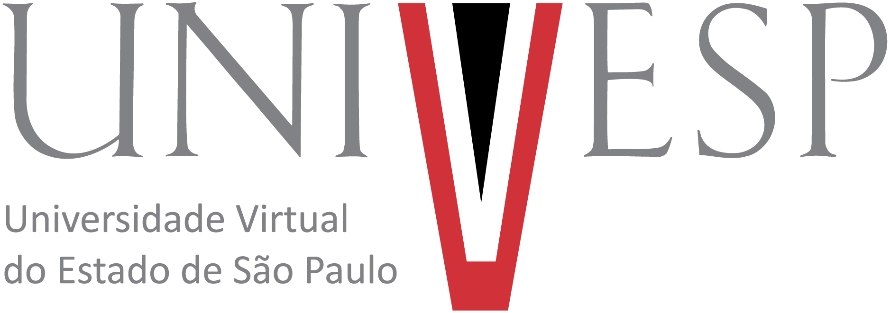

<div align="center">
  
</div>

# O Normal Assusta?

> Réplica educacional interativa sobre distribuição normal padronizada, inspirada no Recurso Educacional Aberto da UNIVESP.

<div align="center">

[](#tecnologias)
[](#tecnologias)
[](#tecnologias)
[](https://apps.univesp.br/o-normal-assusta/)

</div>

Este projeto recria, com uma implementação própria, a experiência didática do site [O Normal Assusta?](https://apps.univesp.br/o-normal-assusta/). A página apresenta a distribuição normal, permite calcular o escore Z e consultar probabilidades na tabela padronizada.

> Este é um projeto independente, feito para estudo e demonstração. A UNIVESP é a instituição responsável pelo recurso original; este repositório não é um produto oficial da universidade.

## 🎯 Por que usar REA?

Este clone também é um exercício para estudar o REA (Reverse Engineer Anything) e novas funcionalidades de engenharia reversa assistida por IA. A proposta é observar uma interface existente, entender sua estrutura e seus fluxos principais e então criar uma implementação própria, adaptada ao estilo desejado.

Nesta sessão, as ferramentas MCP do REA não estavam conectadas. A reconstrução partiu da interface pública e do comportamento visível do recurso original; não houve inspeção do código-fonte interno do site.
## ✨ O que foi feito


- Recriada a página introdutória com a história dos dois frangos e uma explicação visual da curva normal.
- Implementada a padronização de uma observação pela fórmula Z = (X − μ) / σ.
- Adicionada uma consulta direta quando o usuário já conhece o valor de Z.
- Calculadas as probabilidades à esquerda e à direita de Z, além da área entre a média e Z.
- Gerada uma tabela de consulta de 0,00 a 3,99, com busca e destaque do valor correspondente.
- Incluídos exemplos de leitura da curva para interpretar áreas e probabilidades.
- Adicionados layout responsivo, mensagens de validação, navegação por teclado e uma janela de créditos.
- Incluídos os logos oficiais da UNIVESP no cabeçalho e no rodapé, com versões apropriadas para fundos escuros e claros.
- Definido o tema escuro como padrão, com alternância para tema claro no canto superior esquerdo.
- Aplicada a paleta institucional da UNIVESP no tema escuro: vermelho #D13239, cinza #808285, preto e branco.

## ▶️ Como executar

A página não precisa de instalação ou dependências de build. Abra `CLONE_NORMAL_ASSUSTA/index.html` em um navegador.

No PowerShell, a partir da pasta raiz deste repositório:

```powershell
Start-Process .\CLONE_NORMAL_ASSUSTA\index.html
```

Também é possível abrir a pasta `CLONE_NORMAL_ASSUSTA` no VS Code e iniciar `index.html` com a extensão Live Server. As fontes tipográficas remotas podem precisar de conexão com a internet; o restante da página funciona localmente.

## 🧮 Cálculo

A calculadora converte a variável observada em escore padronizado:

```text
Z = (X − μ) / σ
```

Em que μ é a média, σ é o desvio padrão (maior que zero) e X é o valor observado. A tabela apresenta a área entre Z = 0 e |Z|; os resultados à esquerda e à direita são calculados pela função acumulada da distribuição normal padrão. Os valores exibidos são arredondados a quatro casas decimais.

## 🧰 Tecnologias

| Tecnologia | Uso |
|---|---|
| HTML | Estrutura semântica e conteúdo |
| CSS | Identidade visual, responsividade e estados da interface |
| JavaScript | Validação, cálculo de probabilidades e geração da tabela |

O projeto não usa framework nem exige instalação de pacotes.

## 📁 Estrutura

```text
.
├── assets/
│   ├── univesp-logo.png
│   ├── univesp-completo-negativo.svg
│   ├── univesp-completo-positivo.svg
│   ├── univesp-simplificado-negativo.svg
│   └── univesp-simplificado-positivo.svg
└── CLONE_NORMAL_ASSUSTA/
    ├── app.js
    ├── index.html
    └── styles.css
```

## ✅ Conclusão

A engenharia reversa pode ser usada de forma construtiva: neste projeto, serviu como ponto de partida para estudar uma experiência educacional e estruturar rapidamente um site com identidade visual própria. O resultado é uma implementação adaptada ao estilo de quem a criou, com créditos claros à referência e sem se apresentar como produto oficial da UNIVESP. Esse é um exemplo de como ferramentas de engenharia reversa e IA podem apoiar aprendizado e criação quando usadas com transparência e respeito às fontes.
## 🏛️ Referência e créditos


O conteúdo e a proposta educacional foram inspirados no recurso [O Normal Assusta?](https://apps.univesp.br/o-normal-assusta/), desenvolvido pela [Universidade Virtual do Estado de São Paulo (UNIVESP)](https://univesp.br/). A página original informa que o recurso está disponível sob licença MIT e aponta para o [repositório de origem](https://github.com/univesp/o-normal-assusta).

O logo utilizado aqui foi obtido no pacote RGB para uso digital disponibilizado pela própria [página de identidade visual da UNIVESP](https://locomotive.univesp.br/institucional/marca). A marca é mantida como identificação institucional da referência, sem sugerir endosso ao clone.

A interface e a implementação deste clone foram produzidas para fins educacionais. Consulte as fontes oficiais acima para o recurso original, a licença e as diretrizes de uso da marca.


